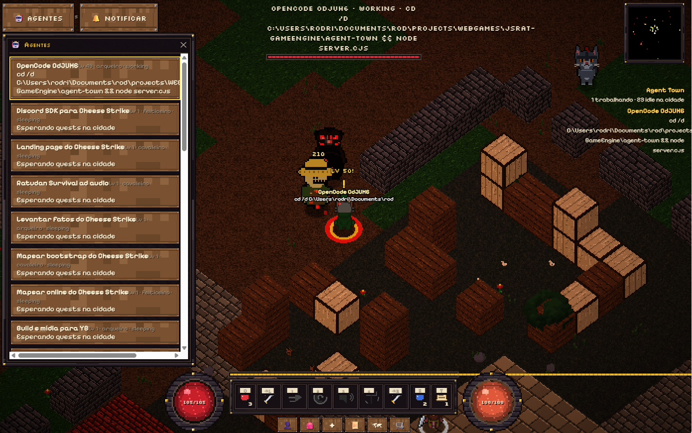

# Agent Town - Ratudan

[](LICENSE)
[](#)
[](CONTRIBUTING.md)

**Watch your local AI coding agents live as RPG characters in a rat city.**  
**Veja seus agentes de IA locais vivendo como personagens RPG em uma cidade de ratos.**  
**Mira tus agentes de IA locales viviendo como personajes RPG en una ciudad de ratas.**

<p align="center">
  
  
</p>

---

## Languages / Idiomas

- [English](#english)
- [Português (Brasil)](#português-brasil)
- [Español](#español)

---

## English

### What is Agent Town?

Agent Town is a **local agent visualizer** built on top of the Rodents Legends / Ratudan RPG world.  
Instead of a dashboard full of logs, your agents appear as characters in a city:

- **Idle** agents hang around the city.
- **Working** agents go out to fight task monsters.
- **Waiting/permission** agents show they need your attention.
- **Sleeping** agents leave through the portal and return when active again.

The goal is to make agent work visible, fun, and easy to understand at a glance.

### Quick start (standalone)

Requirements: **Node.js 18+**.

```bash
git clone https://github.com/roddyka/AgentTown---Ratudan.git
cd AgentTown---Ratudan
node agent-server.cjs
```

Then open:

- **City visualizer:** http://127.0.0.1:47110
- **Agent state API:** http://127.0.0.1:47110/api/state
- **SSE stream:** http://127.0.0.1:47110/stream

No engine install, no build step. The `web/` folder contains the standalone city build and `agent-server.cjs` serves it together with the local agent bridge.

### What this repository contains

- `web/` - standalone 3D city build.
- `agent-server.cjs` - local server + agent bridge (serves web UI and API).
- `assets/`, `levels/`, `design/` - Agent Town/Ratudan game data and assets.
- `docs/` - screenshots and documentation assets.
- `skills/` - optional skill definition for AI coding tools.

### What agents can be detected

The local bridge can detect agent sources such as:

- **OpenCode** sessions/jobs (local OpenCode DB polling)
- **Claude** hook events / process presence
- Known agent processes (Cursor, Codex, Gemini, Copilot, Windsurf, Aider, Cline, etc.)

Detection depends on what is installed/running locally and which hooks/integrations are enabled.

### Privacy

- Agent detection is **local**.
- The bridge reads local machine/session signals and serves them on localhost.
- Do **not** expose the local agent bridge to the public internet.
- This repo does not include cloud telemetry.

### Contributing

Contributions are welcome!

- Open an issue for bugs, ideas, or agent integrations.
- Submit a Pull Request for fixes, docs, UI, detection improvements, or new behaviors.
- Keep PRs focused and describe how to test them.

See [CONTRIBUTING.md](CONTRIBUTING.md).

### Skill publishing / registries

If you want this repo to be installable as an AI skill:

- This repo includes `skills/agent-town/SKILL.md`.
- OpenCode local skill: copy it to `.opencode/skills/agent-town/SKILL.md` or `~/.config/opencode/skills/agent-town/SKILL.md`.
- Vercel Skills ecosystem / skills.sh: public GitHub repos with `SKILL.md` can be installed with:

```bash
npx skills add roddyka/AgentTown---Ratudan
```

Useful references:

- OpenCode Skills: https://opencode.ai/docs/skills/
- Vercel Skills repo: https://github.com/vercel-labs/skills
- skills.sh docs: https://skills.sh/docs

---

## Português (Brasil)

### O que é o Agent Town?

Agent Town é um **visualizador local de agentes** feito em cima do mundo RPG Rodents Legends / Ratudan.  
Em vez de um painel cheio de logs, seus agentes aparecem como personagens na cidade:

- **Idle/ocioso**: fica na cidade esperando.
- **Working/trabalhando**: sai para caçar monstros da tarefa.
- **Waiting/esperando**: mostra que precisa da sua atenção/permissão.
- **Sleeping/dormindo**: sai pelo portal e volta quando ficar ativo.

A ideia é deixar o trabalho dos agentes visível, divertido e fácil de entender.

### Como rodar (standalone)

Requisito: **Node.js 18+**.

```bash
git clone https://github.com/roddyka/AgentTown---Ratudan.git
cd AgentTown---Ratudan
node agent-server.cjs
```

Depois abra:

- **Cidade 3D:** http://127.0.0.1:47110
- **API de estado:** http://127.0.0.1:47110/api/state
- **Stream SSE:** http://127.0.0.1:47110/stream

Sem instalar engine, sem build. A pasta `web/` contém o build standalone da cidade e o `agent-server.cjs` serve a UI e a bridge local.

### O que este repositório contém

- `web/` - build standalone da cidade 3D.
- `agent-server.cjs` - servidor local + bridge de agentes.
- `assets/`, `levels/`, `design/` - dados e assets do Agent Town/Ratudan.
- `docs/` - screenshots e documentação.
- `skills/` - skill opcional para ferramentas de IA.

### Privacidade

- A detecção é **local**.
- A bridge lê sinais/sessões locais e serve em localhost.
- **Não** exponha a bridge na internet pública.
- Este repo não inclui telemetria em nuvem.

### Contribuindo

PRs são bem-vindos! Veja [CONTRIBUTING.md](CONTRIBUTING.md).

---

## Español

### ¿Qué es Agent Town?

Agent Town es un **visualizador local de agentes** construido sobre el mundo RPG Rodents Legends / Ratudan.  
En lugar de un panel lleno de logs, tus agentes aparecen como personajes en una ciudad.

- **Idle**: esperan en la ciudad.
- **Working**: salen a luchar contra monstruos de tareas.
- **Waiting**: necesitan tu atención/permiso.
- **Sleeping**: salen por el portal y vuelven cuando se activan.

### Cómo ejecutarlo (standalone)

Requisito: **Node.js 18+**.

```bash
git clone https://github.com/roddyka/AgentTown---Ratudan.git
cd AgentTown---Ratudan
node agent-server.cjs
```

Abre:

- **Ciudad 3D:** http://127.0.0.1:47110
- **API de estado:** http://127.0.0.1:47110/api/state
- **Stream SSE:** http://127.0.0.1:47110/stream

Sin instalar motor, sin build. La carpeta `web/` contiene el build standalone y `agent-server.cjs` sirve la UI y el bridge local.

### Privacidad

- La detección es **local**.
- No expongas el bridge a internet pública.
- Este repo no incluye telemetría en la nube.

### Contribuir

Los Pull Requests son bienvenidos. Abre un issue o PR con una descripción clara y pasos de prueba.
