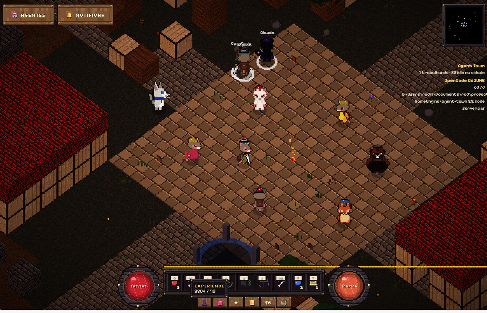

# Agent Town - Ratudan

[](LICENSE)
[](#)
[](CONTRIBUTING.md)

**Watch your local AI coding agents live as RPG characters in a rat city.**  
**Veja seus agentes de IA locais vivendo como personagens RPG em uma cidade de ratos.**  
**Mira tus agentes de IA locales viviendo como personajes RPG en una ciudad de ratas.**

<p align="center">
  
  
</p>

---

## Languages / Idiomas

- [English](#english)
- [Português (Brasil)](#português-brasil)
- [Español](#español)

---

## English

### What is Agent Town?

Agent Town is a **local agent visualizer** built on top of the Rodents Legends / Ratudan RPG world.  
Instead of a dashboard full of logs, your agents appear as characters in a city:

- **Idle** agents hang around the city.
- **Working** agents go out to fight task monsters.
- **Waiting/permission** agents show they need your attention.
- **Sleeping** agents leave through the portal and return when active again.

The goal is to make agent work visible, fun, and easy to understand at a glance.

### What this repository contains

This repo is the **Agent Town pack / bridge**, not the full JSRat GameEngine.

Included here:

- `assets/` - Agent Town / Ratudan RPG assets used by the visualizer.
- `levels/` - Agent Town level data (`vale.json` configured for agent mode).
- `design/` - game/design data.
- `agent-server.cjs` - legacy/local agent bridge that detects local agents and exposes state/events.
- `docs/` - screenshots and documentation assets.
- `skills/` - optional skill definition for AI coding tools.

Not included here:

- The full JSRat GameEngine source.
- Unrelated games/packs from the engine workspace.

### How to run / see your agents

> Agent Town is currently a game pack + local agent bridge. The full 3D city visualizer runs inside **JSRat GameEngine**.

#### Option A - Full visualizer (recommended)

1. Clone and install [JSRat GameEngine](https://github.com/roddyka/jsrat-gameengine).
2. Copy or clone this repository into the engine's `games/agent-town/` folder.
3. Run the engine dev server.
4. Open Agent Town in the engine.

Typical engine flow:

```bash
git clone https://github.com/roddyka/jsrat-gameengine.git
cd jsrat-gameengine
npm install
# place this repo at games/agent-town/
npm run dev
```

The embedded Agent Town API in the engine serves local agent state and the city reads it.

#### Option B - Agent bridge only (legacy/simple)

If you only want the local agent state API:

```bash
node agent-server.cjs
```

Default endpoint: `http://127.0.0.1:47110/api/state`  
SSE stream: `http://127.0.0.1:47110/stream`

This is useful for debugging detection, but it does **not** render the 3D city by itself.

### What agents can be detected

The current bridge/engine integration can detect local agent sources such as:

- **OpenCode** sessions/jobs (local OpenCode DB polling)
- **Claude** hook events / process presence
- Known agent processes (Cursor, Codex, Gemini, Copilot, Windsurf, Aider, Cline, etc.)

Detection depends on what is installed/running locally and which hooks/integrations are enabled.

### Privacy

- Agent detection is **local**.
- The bridge reads local machine/session signals and serves them on localhost.
- Do not expose the local agent bridge to the public internet.
- This repo does not include cloud telemetry.

### Contributing

Contributions are welcome!

- Open an issue for bugs, ideas, or agent integrations.
- Submit a Pull Request for fixes, docs, UI, detection improvements, or new behaviors.
- Keep PRs focused and describe how to test them.

See [CONTRIBUTING.md](CONTRIBUTING.md).

### Skill publishing / registries

If you want this repo to be installable as an AI skill:

- This repo includes `skills/agent-town/SKILL.md`.
- OpenCode local skill: copy it to `.opencode/skills/agent-town/SKILL.md` or `~/.config/opencode/skills/agent-town/SKILL.md`.
- Vercel Skills ecosystem / skills.sh: public GitHub repos with `SKILL.md` can be installed with:

```bash
npx skills add roddyka/AgentTown---Ratudan
```

The skills CLI discovers skills from common locations (`skills/`, `.agents/skills/`, `.claude/skills/`, etc.). Listing/ranking on skills.sh depends on anonymous install telemetry through the `skills` CLI.

Useful references:

- OpenCode Skills: https://opencode.ai/docs/skills/
- Vercel Skills repo: https://github.com/vercel-labs/skills
- skills.sh docs: https://skills.sh/docs

---

## Português (Brasil)

### O que é o Agent Town?

Agent Town é um **visualizador local de agentes** feito em cima do mundo RPG Rodents Legends / Ratudan.  
Em vez de um painel cheio de logs, seus agentes aparecem como personagens na cidade:

- **Idle/ocioso**: fica na cidade esperando.
- **Working/trabalhando**: sai para caçar monstros da tarefa.
- **Waiting/esperando**: mostra que precisa da sua atenção/permissão.
- **Sleeping/dormindo**: sai pelo portal e volta quando ficar ativo.

A ideia é deixar o trabalho dos agentes visível, divertido e fácil de entender.

### O que este repositório contém

Este repo é o **pack/bridge do Agent Town**, não a JSRat GameEngine completa.

Inclui:

- `assets/` - assets RPG do Ratudan usados pelo visualizador.
- `levels/` - dados da fase/cidade (`vale.json` em modo agentes).
- `design/` - dados de design/jogo.
- `agent-server.cjs` - bridge local legado que detecta agentes e expõe estado/eventos.
- `docs/` - screenshots e documentação.
- `skills/` - skill opcional para ferramentas de IA.

Não inclui:

- O código completo da JSRat GameEngine.
- Outros jogos/packs do workspace da engine.

### Como rodar / ver seus agentes

> Hoje o Agent Town é um pack de jogo + bridge local. A cidade 3D completa roda dentro da **JSRat GameEngine**.

#### Opção A - Visualizador completo (recomendado)

1. Clone e instale a [JSRat GameEngine](https://github.com/roddyka/jsrat-gameengine).
2. Copie ou clone este repositório para `games/agent-town/` dentro da engine.
3. Rode o servidor de dev da engine.
4. Abra o Agent Town.

Fluxo típico:

```bash
git clone https://github.com/roddyka/jsrat-gameengine.git
cd jsrat-gameengine
npm install
# coloque este repo em games/agent-town/
npm run dev
```

#### Opção B - Só a bridge de agentes (legado/simples)

Para expor apenas o estado local dos agentes:

```bash
node agent-server.cjs
```

Endpoint padrão: `http://127.0.0.1:47110/api/state`  
Stream SSE: `http://127.0.0.1:47110/stream`

Isso ajuda a depurar detecção, mas **não** renderiza a cidade 3D sozinho.

### Privacidade

- A detecção é **local**.
- A bridge lê sinais/sessões locais e serve em localhost.
- Não exponha a bridge na internet pública.
- Este repo não inclui telemetria em nuvem.

### Contribuindo

PRs são bem-vindos! Veja [CONTRIBUTING.md](CONTRIBUTING.md).

---

## Español

### ¿Qué es Agent Town?

Agent Town es un **visualizador local de agentes** construido sobre el mundo RPG Rodents Legends / Ratudan.  
En lugar de un panel lleno de logs, tus agentes aparecen como personajes en una ciudad.

- **Idle**: esperan en la ciudad.
- **Working**: salen a luchar contra monstruos de tareas.
- **Waiting**: necesitan tu atención/permiso.
- **Sleeping**: salen por el portal y vuelven cuando se activan.

### Qué incluye este repositorio

Este repo es el **pack/bridge de Agent Town**, no el motor JSRat GameEngine completo.

Incluye assets, nivel, diseño, bridge local de agentes, screenshots y una skill opcional.  
No incluye el código completo del motor ni otros juegos.

### Cómo ejecutarlo

La ciudad 3D completa se ejecuta dentro de **JSRat GameEngine**. Coloca este repo en `games/agent-town/` dentro del motor y ejecuta el entorno de desarrollo.

Para depurar solo la detección local:

```bash
node agent-server.cjs
```

### Contribuir

Los Pull Requests son bienvenidos. Abre un issue o PR con una descripción clara y pasos de prueba.
